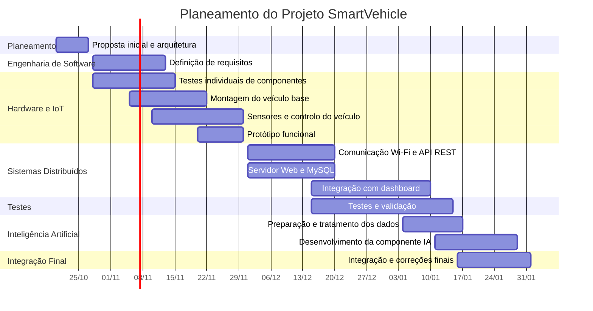

# SmartVehicle – Proposta Inicial do Projeto

## 1. Identificação do Projeto

**Universidade:** Universidade Europeia  
**Faculdade/Escola:** IADE – Faculdade de Design, Tecnologia e Comunicação  
**Curso:** Licenciatura em Engenharia Informática  
**Ano letivo:** 2026/2027  
**Semestre:** 5.º Semestre  

**Nome do Projeto:** SmartVehicle – Veículo Conectado com Dashboard Digital  

**Grupo: 2**

**Elementos do Grupo:**
- Joao Santos - 50031111; 
- Tomas Pereira - 20241740;
- Rui Grosso - 20241591;
- Gonçalo Pereira - 20241565;

**Unidades Curriculares envolvidas:**
- Sistemas Distribuídos
- Computação Física e IoT
- Inteligência Artificial
- Engenharia de Software

**Palavras-chave:** ESP32, IoT, SmartVehicle, sensores, atuadores, telemetria, dashboard digital, sistemas distribuídos, inteligência artificial.

**Repositório GitHub:** [colocar aqui o link do repositório]

## 2. Descrição do Projeto

O SmartVehicle é um protótipo de um pequeno veículo inteligente baseado no microcontrolador ESP32.

O objetivo é construir um veículo físico capaz de se movimentar, utilizar sensores e executar algumas funções semelhantes às existentes num automóvel moderno.

O veículo deverá conseguir avançar, recuar, virar e parar. Pretende-se também implementar funcionalidades como faróis, piscas, buzina, medição de velocidade e deteção de obstáculos.

Será desenvolvido um dashboard digital que permitirá controlar o veículo e visualizar informação sobre o seu funcionamento, como velocidade, distância a obstáculos e estado de alguns dos seus sistemas.

O ESP32 será responsável pelo controlo do veículo e pela recolha de dados dos sensores. Esses dados serão enviados através de Wi-Fi para um servidor, onde poderão ser armazenados numa base de dados e utilizados pelo dashboard e pela componente de Inteligência Artificial.

O projeto será desenvolvido de forma progressiva, começando pelas funções mais simples do veículo e acrescentando posteriormente sensores, comunicação, dashboard e outras funcionalidades.

## 3. Problema e Motivação

Os automóveis modernos utilizam vários sistemas eletrónicos que trabalham em conjunto, como sensores, unidades de controlo, sistemas de iluminação, medição de velocidade, deteção de obstáculos e comunicação entre diferentes componentes.

O SmartVehicle pretende criar uma versão simplificada deste tipo de sistema, utilizando um pequeno veículo físico e componentes de baixo custo.

A escolha deste projeto permite aplicar, num único protótipo, conhecimentos de hardware, programação, Internet of Things, Sistemas Distribuídos, Engenharia de Software e Inteligência Artificial.

Outra motivação é trabalhar com dados reais recolhidos pelos sensores do veículo. Esses dados poderão ser transmitidos, armazenados e posteriormente utilizados pelo dashboard e pela componente de Inteligência Artificial.

O projeto também permite desenvolver a solução de forma progressiva, começando por funcionalidades básicas e acrescentando novas capacidades à medida que o desenvolvimento avança.

## 4. Objetivos

O principal objetivo do SmartVehicle é desenvolver um pequeno veículo conectado, baseado em ESP32, capaz de ser controlado através de um dashboard digital e de recolher dados do seu funcionamento através de sensores.

### Funcionalidades Essenciais – MVP

A primeira prioridade do projeto será desenvolver um protótipo funcional com as seguintes capacidades:

- controlar o movimento do veículo;
- permitir avançar, recuar, virar e parar;
- controlar os dois motores através do ESP32;
- medir a distância a obstáculos;
- medir a rotação das rodas e estimar a velocidade;
- comunicar através de Wi-Fi;
- enviar dados do veículo para um servidor;
- armazenar os dados recolhidos numa base de dados MySQL;
- apresentar informação básica num dashboard digital;
- permitir o envio de comandos através do dashboard.

Estas funcionalidades constituem o núcleo mínimo do SmartVehicle e terão prioridade durante o desenvolvimento.

### Funcionalidades Complementares

Depois de o núcleo principal estar funcional, poderão ser integradas outras funcionalidades, como:

- faróis;
- piscas;
- buzina;
- deteção da luminosidade ambiente;
- medição da temperatura;
- luzes de travagem;
- luz de marcha-atrás;
- outras funcionalidades que se revelem viáveis durante o desenvolvimento.

### Inteligência Artificial

O projeto deverá também incluir uma componente de Inteligência Artificial.

Esta componente utilizará os dados recolhidos pelos sensores do SmartVehicle, juntamente com pelo menos uma fonte de dados adicional, para realizar uma função analítica ou preditiva.

A funcionalidade concreta da componente de Inteligência Artificial será definida numa fase posterior do projeto, de acordo com os conteúdos e requisitos da respetiva Unidade Curricular.

## 5. Público-Alvo

O SmartVehicle é principalmente um projeto académico e demonstrativo.

O protótipo destina-se sobretudo a estudantes, docentes e utilizadores interessados em perceber como diferentes áreas da Engenharia Informática podem ser integradas num único sistema.

O projeto permite demonstrar, de forma prática, a ligação entre:

- microcontroladores;
- sensores e atuadores;
- Internet of Things;
- comunicação entre sistemas;
- armazenamento de dados;
- desenvolvimento de software;
- Inteligência Artificial.

O dashboard será a principal interface de utilização do sistema, permitindo controlar o veículo e acompanhar os dados recolhidos pelos sensores.

O SmartVehicle não pretende ser um produto comercial, mas sim uma plataforma de aprendizagem, demonstração e experimentação.

## 6. Guiões de Teste

### Guião de Teste 1 – Controlo do Movimento

**Objetivo:**  
Verificar se o utilizador consegue controlar corretamente o movimento do SmartVehicle através do dashboard.

**Passos:**

1. Ligar o SmartVehicle.
2. Abrir o dashboard digital.
3. Confirmar que existe comunicação com o veículo.
4. Selecionar o comando para avançar.
5. Confirmar que o veículo se desloca para a frente.
6. Selecionar o comando para virar à esquerda.
7. Confirmar que o veículo altera a direção.
8. Selecionar o comando para virar à direita.
9. Confirmar que o veículo altera a direção.
10. Selecionar o comando para parar.
11. Confirmar que o veículo fica imobilizado.

**Resultado esperado:**  
O veículo deverá responder corretamente aos comandos enviados através do dashboard.

---

### Guião de Teste 2 – Deteção de Obstáculos

**Objetivo:**  
Verificar se o SmartVehicle consegue detetar um obstáculo à sua frente e impedir uma aproximação considerada insegura.

**Passos:**

1. Ligar o SmartVehicle.
2. Colocar um obstáculo à frente do veículo.
3. Colocar o veículo em movimento para a frente.
4. Confirmar que o sensor frontal mede a distância ao obstáculo.
5. Confirmar que essa distância é apresentada no dashboard.
6. Aproximar o veículo do obstáculo.
7. Verificar se o sistema identifica quando a distância fica abaixo do limite de segurança.
8. Confirmar que o veículo deixa de avançar.

**Resultado esperado:**  
O sistema deverá detetar o obstáculo, apresentar a distância no dashboard e impedir o avanço quando a distância for considerada insegura.

---

### Guião de Teste 3 – Iluminação do Veículo

**Objetivo:**  
Verificar se os sistemas de iluminação respondem aos comandos do utilizador.

**Passos:**

1. Ligar o SmartVehicle.
2. Abrir o dashboard.
3. Ativar os faróis.
4. Confirmar que os LEDs correspondentes aos faróis acendem.
5. Ativar o pisca esquerdo.
6. Confirmar que o indicador luminoso esquerdo pisca.
7. Desativar o pisca esquerdo.
8. Ativar o pisca direito.
9. Confirmar que o indicador luminoso direito pisca.
10. Desligar os sistemas de iluminação.

**Resultado esperado:**  
As luzes deverão responder corretamente aos comandos enviados pelo utilizador.

## 7. Enquadramento nas Unidades Curriculares

O SmartVehicle integra conteúdos das quatro Unidades Curriculares envolvidas no PBL.

### Sistemas Distribuídos

Nesta Unidade Curricular será trabalhada a arquitetura que permite a comunicação entre os diferentes componentes do sistema.

O SmartVehicle deverá enviar dados através de Wi-Fi para um servidor, permitindo posteriormente a sua utilização por outros componentes da solução, como o dashboard, a base de dados e a componente de Inteligência Artificial.

Será também trabalhado o planeamento e a gestão do projeto.

### Computação Física e IoT

Esta Unidade Curricular estará diretamente relacionada com o desenvolvimento do veículo físico.

Serão trabalhados:

- programação do ESP32;
- utilização de sensores;
- utilização de atuadores;
- controlo dos motores;
- recolha de dados;
- comunicação através de Wi-Fi;
- envio dos dados recolhidos para o servidor.

### Engenharia de Software

Nesta Unidade Curricular serão definidos e especificados os requisitos do sistema.

Serão também trabalhados:

- requisitos funcionais;
- requisitos não funcionais;
- modelação da solução;
- testes;
- validação do sistema.

### Inteligência Artificial

Nesta Unidade Curricular serão utilizados os dados recolhidos pelo SmartVehicle para desenvolver uma componente analítica ou preditiva.

Os dados provenientes dos sensores deverão ser combinados com pelo menos uma fonte adicional de dados.

A componente de Inteligência Artificial será definida e desenvolvida numa fase posterior, de acordo com os requisitos e conteúdos da UC.

## 8. Requisitos Técnicos e Tecnologias

Nesta fase do projeto, os requisitos técnicos e as tecnologias ainda são preliminares e poderão ser ajustados durante o desenvolvimento.

### Requisitos Técnicos

O sistema deverá:

- utilizar um microcontrolador ESP32;
- permitir a ligação de sensores e atuadores;
- controlar dois motores DC;
- recolher dados dos sensores;
- comunicar através de Wi-Fi;
- enviar os dados recolhidos para um servidor;
- utilizar comunicação REST para envio e receção de informação;
- armazenar informação numa base de dados MySQL;
- disponibilizar os dados ao dashboard;
- permitir o envio de comandos do dashboard para o veículo;
- utilizar os dados recolhidos numa componente de Inteligência Artificial.

### Tecnologias Preliminares

**Hardware:**
- ESP32;
- chassis 2WD;
- motores DC;
- controlador de motores TB6612FNG;
- sensor ultrassónico HC-SR04;
- sensores óticos LM393;
- discos encoder;
- LEDs;
- buzzer;
- sensor de luminosidade;
- sensor de temperatura.

**Software e Ferramentas:**
- Arduino IDE;
- Wokwi;
- Git;
- GitHub;
- HTML;
- CSS;
- JavaScript;
- servidor Web / backend;
- API REST;
- MySQL.

As tecnologias específicas para o backend e para a componente de Inteligência Artificial serão definidas posteriormente.

## 9. Arquitetura da Solução

A arquitetura do SmartVehicle será composta por vários componentes que comunicam entre si.

O ESP32 será a unidade principal do veículo. Este será responsável pela leitura dos sensores, controlo dos motores e ativação dos diferentes atuadores.

A comunicação com o restante sistema será realizada através de Wi-Fi. O ESP32 enviará os dados recolhidos para um servidor Web através de uma API REST.

O servidor será responsável por receber e disponibilizar a informação do veículo e por armazenar os dados numa base de dados MySQL.

O dashboard digital permitirá ao utilizador visualizar os dados do veículo e enviar comandos para o sistema.

A componente de Inteligência Artificial utilizará dados recolhidos pelos sensores do SmartVehicle em conjunto com pelo menos uma fonte de dados adicional. A fonte adicional será definida posteriormente de acordo com a solução desenvolvida na Unidade Curricular de Inteligência Artificial.

A arquitetura preliminar será:

```
                        ┌──────────────────────┐
                        │  Dashboard Digital   │
                        │ controlo + informação│
                        └──────────┬───────────┘
                                   │
                                   │
                                   ▼
                        ┌──────────────────────┐
                        │ Servidor Web /       │
                        │ API REST             │
                        └───────┬───────┬──────┘
                                │       │
                                │       ▼
                                │   ┌───────────────┐
                                │   │ Base de Dados │
                                │   │     MySQL     │
                                │   └───────┬───────┘
                                │           │
                                │           ▼
                                │   ┌────────────────┐
                                │   │ Inteligência   │◄──── Fonte de
                                │   │ Artificial     │      dados adicional
                                │   └────────────────┘
                                │
                              Wi-Fi
                                │
                                ▼
                        ┌──────────────────────┐
                        │        ESP32         │
                        └──────────┬───────────┘
                                   │
                          ┌────────┴────────┐
                          ▼                 ▼
                     ┌─────────┐       ┌──────────┐
                     │Sensores │       │Atuadores │
                     └─────────┘       └──────────┘
```

### Fluxo principal de dados

1. Os sensores recolhem informação do veículo.
2. O ESP32 recebe e processa os dados dos sensores.
3. Os dados são enviados através de Wi-Fi para o servidor Web.
4. O servidor recebe os dados através da API REST.
5. Os dados são armazenados numa base de dados MySQL.
6. O dashboard consulta e apresenta a informação ao utilizador.
7. O utilizador poderá enviar comandos através do dashboard.
8. A componente de Inteligência Artificial utilizará os dados do veículo juntamente com uma fonte de dados adicional para realizar análise ou previsão.

Esta arquitetura é preliminar e poderá ser ajustada durante o desenvolvimento e integração do projeto.

## 10. Hardware e Software

### Hardware Essencial

Os componentes essenciais são os necessários para construir e testar o núcleo funcional do SmartVehicle.

| Componente | Função no Projeto |
|---|---|
| ESP32 | Unidade principal de controlo do veículo |
| Chassis 2WD | Estrutura física do SmartVehicle |
| 2 Motores DC | Movimento do veículo |
| TB6612FNG | Controlo dos motores |
| HC-SR04 | Medição da distância a obstáculos |
| 2 módulos de sensor ótico de velocidade com LM393 | Leitura dos discos encoder |
| Discos Encoder | Permitem medir a rotação das rodas |
| Breadboard | Montagem e teste dos circuitos |
| Cabos de ligação | Ligação entre os diferentes componentes |
| Sistema de alimentação | Alimentação dos motores e dos restantes componentes |

### Hardware Complementar

Depois de o núcleo principal estar funcional, poderão ser utilizados outros componentes para adicionar novas funcionalidades:

| Componente | Função Prevista |
|---|---|
| LEDs | Faróis, piscas e outras luzes do veículo |
| Buzzer | Simulação da buzina |
| Sensor de luminosidade | Deteção da luz ambiente |
| Sensor de temperatura | Medição da temperatura |
| Outros componentes | Funcionalidades adicionais que se revelem viáveis |

### Software e Tecnologias

Durante o desenvolvimento prevê-se utilizar:

| Software / Tecnologia | Utilização |
|---|---|
| Arduino IDE | Programação do ESP32 |
| Wokwi | Simulação e testes de circuitos quando necessário |
| Git | Controlo de versões |
| GitHub | Repositório do projeto e documentação |
| HTML | Estrutura do dashboard |
| CSS | Aspeto visual do dashboard |
| JavaScript | Comportamento e interação do dashboard |
| API REST | Comunicação entre o ESP32 e o servidor |
| MySQL | Armazenamento dos dados recolhidos |
| Backend / Servidor Web | Receção, processamento e disponibilização dos dados |

As tecnologias específicas utilizadas no backend e na componente de Inteligência Artificial ainda serão definidas durante o desenvolvimento.

## 11. Artefacto Físico

O artefacto físico do projeto será um pequeno veículo de duas rodas motrizes, construído sobre um chassis 2WD.

O ESP32 será instalado no veículo e funcionará como unidade principal de controlo. Este receberá informação dos sensores e controlará os motores e os diferentes atuadores.

Na parte frontal do veículo será instalado um sensor ultrassónico HC-SR04 para medir a distância a obstáculos.

Junto às rodas serão utilizados discos encoder e sensores óticos LM393, permitindo contar as rotações das rodas e calcular valores como velocidade e distância percorrida.

Serão também instalados LEDs para representar os sistemas de iluminação do veículo e um buzzer para representar a buzina.

A disposição preliminar dos componentes será semelhante à seguinte:

```
                 FRENTE DO VEÍCULO

                 [ HC-SR04 ]
                     │
        [LED]                    [LED]
       Farol E                  Farol D

              ┌─────────────┐
              │    ESP32    │
              │             │
              │  TB6612FNG  │
              └─────────────┘

       Sensor LM393        Sensor LM393
             │                  │
        Encoder E           Encoder D
             │                  │
          Motor E            Motor D

              [ Alimentação ]

                 TRASEIRA
```

Esta disposição é apenas uma representação preliminar. A posição final dos componentes poderá ser alterada durante a montagem, dependendo do espaço disponível no chassis e das necessidades das ligações elétricas.

O desenvolvimento físico será realizado de forma progressiva. Inicialmente serão testados separadamente o ESP32, LEDs, sensores e motores. Posteriormente, os componentes serão integrados no chassis até formar o protótipo completo.

## 12. Planeamento e Calendarização

O desenvolvimento do SmartVehicle será realizado de forma incremental. Cada fase deverá produzir uma parte funcional do sistema antes de avançar para a integração seguinte.

| Período / Entrega | Trabalho Previsto |
|---|---|
| Até 27/10/2026 | Definição da ideia, objetivos, arquitetura preliminar, hardware, software, planeamento e documentação da proposta inicial |
| Final de outubro / início de novembro | Preparação do ambiente de desenvolvimento e primeiros testes com ESP32 |
| Novembro | Testes individuais de LEDs, buzzer, sensores, motores e controlador TB6612FNG |
| Até 13/11/2026 | Definição dos requisitos funcionais e não funcionais para Engenharia de Software |
| Novembro | Montagem do chassis 2WD e implementação dos movimentos básicos |
| Novembro | Integração do sensor de obstáculos e sensores de velocidade |
| Até 30/11/2026 | Desenvolvimento de um primeiro protótipo funcional integrando hardware e software |
| Dezembro | Desenvolvimento da comunicação Wi-Fi, API REST, servidor e base de dados MySQL |
| Dezembro / janeiro | Desenvolvimento e integração do dashboard digital |
| Janeiro | Integração dos restantes sensores, atuadores e funcionalidades do veículo |
| Até 15/01/2027 | Desenvolvimento e documentação do plano de testes |
| Janeiro | Preparação dos dados e desenvolvimento da componente de Inteligência Artificial |
| Até 29/01/2027 | Conclusão da componente de Inteligência Artificial |
| Até 01/02/2027 | Integração final, testes, correções, documentação e entrega final do projeto |

### Gráfico de Gantt

O seguinte gráfico apresenta a calendarização preliminar das principais atividades do projeto. As datas poderão ser ajustadas de acordo com a evolução do desenvolvimento.



### Fases de Desenvolvimento

O projeto será dividido nas seguintes fases:

1. **Planeamento e investigação**  
   Definição do problema, funcionalidades, requisitos, arquitetura e componentes necessários.

2. **Aprendizagem e testes individuais**  
   Teste do ESP32 e de cada sensor ou atuador separadamente antes da montagem no veículo.

3. **Construção do veículo base**  
   Montagem do chassis, motores e controlador dos motores, permitindo avançar, recuar, virar e parar.

4. **Integração de sensores e sistemas do veículo**  
   Adição do sensor de obstáculos, encoders, iluminação, buzina e outros componentes.

5. **Comunicação e armazenamento de dados**  
   Ligação do ESP32 através de Wi-Fi ao servidor, utilização da API REST e armazenamento dos dados em MySQL.

6. **Dashboard digital**  
   Desenvolvimento da interface para controlo do veículo e visualização dos dados.

7. **Inteligência Artificial**  
   Preparação dos dados e desenvolvimento da componente analítica ou preditiva.

8. **Integração e testes finais**  
   Integração de todos os componentes, realização dos testes definidos e correção dos problemas encontrados.

## 13. Distribuição de Tarefas

A distribuição de tarefas será feita de forma colaborativa, procurando que todos os elementos participem no desenvolvimento e compreendam as diferentes partes do projeto.

Nesta fase, a distribuição preliminar é a seguinte:

| Elemento | Responsabilidades Principais |
|---|---|
| [Nome do elemento 1] | Planeamento do projeto, documentação, apoio à arquitetura e integração geral |
| [Nome do elemento 2] | Programação do ESP32, sensores e atuadores |
| [Nome do elemento 3] | Backend, API REST e base de dados MySQL |
| [Nome do elemento 4] | Dashboard, testes e apoio à componente de Inteligência Artificial |

Apesar desta divisão inicial, algumas tarefas serão realizadas em conjunto, principalmente:

- montagem e testes do protótipo físico;
- integração entre hardware e software;
- testes do sistema;
- documentação;
- preparação das apresentações;
- resolução de problemas durante o desenvolvimento.

A distribuição poderá ser ajustada ao longo do projeto, dependendo da evolução do trabalho, das dificuldades encontradas e da disponibilidade dos elementos do grupo.

## 14. Riscos do Projeto

Durante o desenvolvimento do SmartVehicle poderão surgir dificuldades técnicas e de organização. Os principais riscos identificados nesta fase são os seguintes:

| Risco | Impacto Possível | Medida de Mitigação |
|---|---|---|
| Atraso na chegada de componentes | Pode atrasar a montagem do protótipo | Utilizar Wokwi e testar antecipadamente o software sempre que possível |
| Dificuldades na programação do ESP32 | Pode atrasar a implementação das funcionalidades | Desenvolver e testar cada funcionalidade separadamente |
| Problemas de ligação entre componentes | Sensores, motores ou atuadores podem não funcionar corretamente | Testar individualmente cada componente antes da integração |
| Problemas de alimentação elétrica | Pode causar funcionamento instável ou danificar componentes | Confirmar tensões e ligações antes de alimentar o circuito |
| Problemas na comunicação Wi-Fi | Pode impedir a transmissão de dados e comandos | Testar primeiro a comunicação de forma simples antes de integrar o sistema completo |
| Dificuldades na integração entre ESP32, servidor, base de dados e dashboard | Pode provocar atrasos na fase de integração | Desenvolver e validar cada parte separadamente antes da integração final |
| Excesso de funcionalidades | Pode tornar o projeto demasiado complexo para o tempo disponível | Dar prioridade às funcionalidades essenciais e implementar extras apenas se existir tempo |
| Complexidade da componente de Inteligência Artificial | Pode dificultar a conclusão da integração final | Definir uma solução simples e adequada aos dados disponíveis |
| Falta de tempo para testes finais | Pode deixar erros por corrigir | Realizar testes ao longo de todo o desenvolvimento e não apenas no final |

Para reduzir estes riscos, o projeto será desenvolvido de forma incremental. Cada componente deverá ser testado individualmente antes de ser integrado no sistema completo.

As funcionalidades essenciais terão prioridade sobre funcionalidades adicionais. Desta forma, pretende-se garantir primeiro um protótipo funcional e só depois acrescentar novas capacidades.

## 15. Conclusão

O SmartVehicle pretende integrar, num único projeto, diferentes áreas da Engenharia Informática através do desenvolvimento de um pequeno veículo inteligente conectado.

O projeto combina hardware, sensores, atuadores, programação, comunicação através de Wi-Fi, armazenamento de dados, desenvolvimento de software e Inteligência Artificial.

A solução será desenvolvida de forma progressiva, começando pelas funcionalidades essenciais do veículo e evoluindo posteriormente para a comunicação com o servidor, armazenamento em base de dados, dashboard digital e componente de Inteligência Artificial.

Nesta fase inicial foram definidos o conceito do projeto, os principais objetivos, a arquitetura preliminar, as tecnologias previstas, o artefacto físico e o plano de desenvolvimento.

As próximas fases serão dedicadas à implementação e teste dos diferentes componentes, procurando garantir primeiro um protótipo simples e funcional antes da introdução de funcionalidades adicionais.
